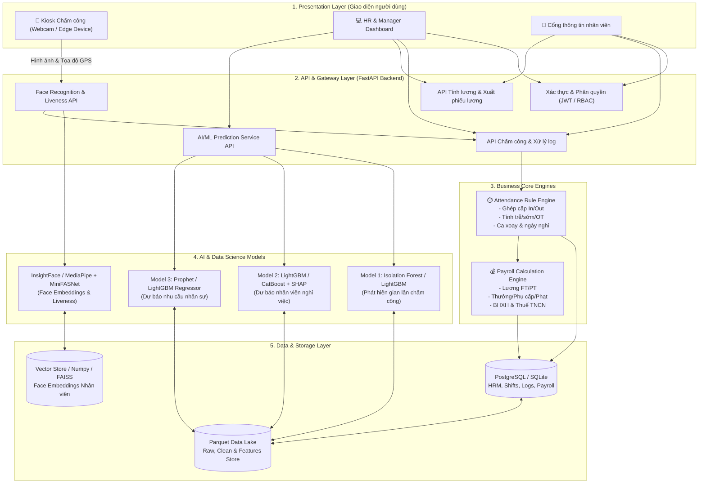
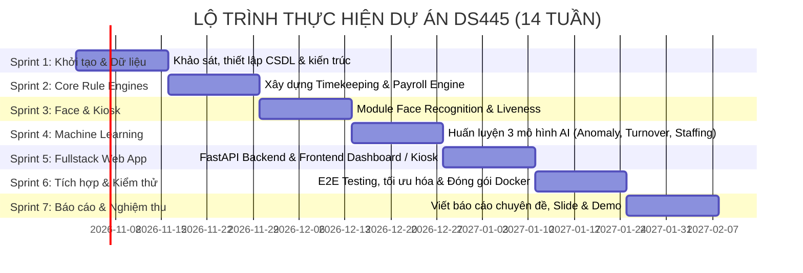

# KẾ HOẠCH TRIỂN KHAI ĐỒ ÁN (PLAN.MD)
## HỆ THỐNG CHẤM CÔNG THÔNG MINH & TÍNH LƯƠNG TỰ ĐỘNG BẰNG NHẬN DIỆN KHUÔN MẶT
**Học phần / Môn học:** Đồ án Khoa học Dữ liệu (DS445)  
**Tên dự án:** HRM & Automated Payroll System with Face Recognition & AI Analytics  
**Bối cảnh ứng dụng:** Chuỗi F&B / Cafe đa chi nhánh (*Cafe Biển Xanh - 4 chi nhánh tại Đà Nẵng*)  
**Trạng thái tài liệu:** Bản chính thức (v1.0)

---

## 1. TỔNG QUAN DỰ ÁN & MỤC TIÊU CỐT LÕI

### 1.1. Bối cảnh & Vấn đề thực tế
Tại các doanh nghiệp chuỗi bán lẻ / F&B với nhiều chi nhánh:
- **Tình trạng gian lận chấm công:** Chấm công hộ bằng thẻ từ, gian lận vị trí GPS, sử dụng ảnh/video để đánh lừa máy chấm công thông thường.
- **Tính toán chấm công & bảng lương thủ công phức tạp:** Quy mô nhân sự kết hợp cả Full-time (lương tháng cố định) và Part-time (lương theo giờ, lịch ca linh hoạt, sinh viên làm thêm), xử lý làm thêm giờ (OT), làm ngày lễ (300%), ngày nghỉ (200%), trừ đi trễ/về sớm, trích nộp Bảo hiểm xã hội (BHXH) và Thuế thu nhập cá nhân (TNCN) luỹ tiến.
- **Thiếu dự báo thông minh:** Quản lý không nắm bắt được tỷ lệ nhân viên có nguy cơ nghỉ việc (attrition), không dự báo được nhu cầu nhân sự vào các khung giờ cao điểm dẫn đến lãng phí chi phí nhân công hoặc thiếu người phục vụ khách.

### 1.2. Mục tiêu đồ án
1. **Computer Vision & Anti-spoofing:** Xây dựng Kiosk chấm công nhận diện khuôn mặt thời gian thực (<0.5s/lượt), tích hợp liveness detection (chống giả mạo bằng ảnh/video màn hình) và xác thực vị trí chi nhánh (GPS Geofencing).
2. **Rule Engine Chấm công & Tính lương:** Tự động hóa 100% quy trình từ log quét thẻ/mặt thô -> bảng công ngày -> bảng tính lương tháng chi tiết, tuân thủ đúng quy định Luật Lao động Việt Nam hiện hành.
3. **Machine Learning / Data Science (3 bài toán trọng tâm):**
   - **Model 1 (Fraud & Anomaly Detection):** Phát hiện bất thường chấm công (gian lận GPS, chấm ngoài giờ, spoofing, spam quét, chấm hộ).
   - **Model 2 (Employee Attrition Prediction):** Dự báo nguy cơ nghỉ việc của nhân viên (phục vụ chiến lược giữ chân nhân tài của HR) kèm giải thích đặc trưng (Explainable AI - SHAP).
   - **Model 3 (Staffing Demand Forecasting):** Dự báo nhu cầu nhân sự theo từng khung giờ tại từng chi nhánh dựa trên dữ liệu doanh thu, đơn hàng, thời tiết và tính chu kỳ.
4. **Hệ thống Full-stack hoàn chỉnh:**
   - **Kiosk Web:** Màn hình chấm công camera tại cửa hàng.
   - **Admin/HR Portal:** Bảng điều khiển quản lý nhân sự, duyệt đơn nghỉ phép, cấu hình ca, xem bảng công, chốt lương và báo cáo phân tích AI.
   - **Employee Self-service:** Cổng nhân viên xem lịch ca, lịch sử chấm công và phiếu lương cá nhân.

---

## 2. KIẾN TRÚC TỔNG THỂ HỆ THỐNG (SYSTEM ARCHITECTURE)

---

## 3. PHÂN RÃ CÁC PHÂN HỆ VÀ TÍNH NĂNG CHI TIẾT

### Phân hệ 1: Computer Vision & Kiosk Chấm công
- **Face Detection & Alignment:** Sử dụng `RetinaFace` hoặc `MediaPipe Face Detection` trích xuất khung mặt chuẩn hóa.
- **Feature Extraction (Face Embedding):** Sử dụng `ArcFace` / `MobileFaceNet` trích xuất vector đặc trưng 512 chiều.
- **Vector Matching:** So khớp vector khuôn mặt với cơ sở dữ liệu nhân viên (khoảng cách Cosine hoặc Euclidean Distance). Đặt ngưỡng tin cậy (accept threshold $\ge 0.55$).
- **Anti-spoofing / Liveness Detection:** Sử dụng `MiniFASNet` hoặc mô hình phân loại đa quang phổ / chuyển động chớp mắt để ngăn chặn chụp lại màn hình điện thoại, in ảnh giấy.
- **Geofencing & Device Verification:** Tính khoảng cách Haversine giữa tọa độ GPS của thiết bị quét và tọa độ chi nhánh (`branches.lat`, `branches.lon`), cảnh báo nếu lệch $>50\text{m}$.
- **Fallback Mechanism:** Hỗ trợ quét mã QR động hoặc người quản lý xác nhận thủ công nếu camera gặp sự cố kỹ thuật.

### Phân hệ 2: Rule Engine Chấm công (Timekeeping Engine)
- **Chuẩn hóa lượt quét:** Lọc duplicate scans (nhiều lần quét liên tục trong 1-2 phút).
- **Ghép cặp Check-in / Check-out:** Tự động phân định ca làm việc theo lịch đăng ký (`planned_start`, `planned_end`).
- **Xử lý vi phạm & Bổ sung:**
  - Áp dụng thời gian ân hạn (Grace period: ví dụ 5 phút).
  - Tính chính xác phút đi trễ (`late_minutes`), về sớm (`early_leave_minutes`).
  - Xử lý tăng ca (`ot_hours` làm tròn mỗi 30 phút).
  - Tự động đánh dấu `is_manual_fix` khi quản lý bổ sung giờ chấm do nhân viên quên chấm ra.
- **Xử lý ngày phép & ngày lễ:** Tích hợp đơn xin nghỉ (`leave_requests` đã duyệt: phép năm, nghỉ ốm, nghỉ không lương) và danh mục ngày lễ (`holidays`).

### Phân hệ 3: Engine Tính lương Tự động (Payroll Engine)
Tuân thủ Luật Lao động & quy chuẩn kế toán Việt Nam:
- **Nhân viên Full-Time (FT):**
  - Lương theo ngày công: $\text{Base Pay} = \frac{\text{Lương cơ bản}}{\text{Số ngày chuẩn}} \times (\text{Ngày đi làm} + \text{Ngày phép hưởng lương} + \text{Ngày lễ})$.
  - Giờ làm thêm thường (150%), ngày nghỉ tuần (200%), ngày lễ (300%).
  - Trích nộp Bảo hiểm (BHXH 8%, BHYT 1.5%, BHTN 1% = 10.5% NLĐ; 21.5% Doanh nghiệp).
  - Thuế TNCN luỹ tiến từng phần: Sau khi giảm trừ bản thân (11.000.000đ/tháng) và người phụ thuộc (4.400.000đ/người/tháng).
- **Nhân viên Part-Time (PT):**
  - $\text{Base Pay} = \text{Tổng giờ thực làm} \times \text{Lương theo giờ (hourly\_rate)}$.
  - Hệ số OT ngày lễ, ngày nghỉ đặc biệt.
- **Phụ cấp & Thưởng / Phạt:**
  - Phụ cấp tiền ăn ca (`allowance_meal`), phụ cấp trách nhiệm quản lý (`allowance_other`).
  - Thưởng chuyên cần (`bonus_attendance`) khi không đi trễ và đủ công.
  - Thưởng doanh thu chi nhánh (`bonus_sales`).
  - Khấu trừ phạt đi trễ vượt quy định (`late_deduction`).
- **Xuất dữ liệu:** Bảng tổng hợp lương (Payroll Summary) và Phiếu lương chi tiết (Payslip PDF).

### Phân hệ 4: Bộ 3 Mô hình Khoa học Dữ liệu & Học máy (DS & Machine Learning)
Dựa trên bộ dữ liệu `features/` đã được kỹ nghệ công phu:

| Tên mô hình | File dữ liệu huấn luyện | Mục tiêu nghiệp vụ | Thuật toán đề xuất | Chỉ số đánh giá |
|---|---|---|---|---|
| **1. Anomaly Detection (Gian lận chấm công)** | `features_anomaly.parquet` (50,838 dòng) & `labels_anomaly.parquet` | Phát hiện hành vi gian lận (GPS giả, liveness thấp, tráo người, quét ngoài giờ) | Isolation Forest, LightGBM Classifier, Autoencoder | F1-Score, Precision, Recall, AUC-ROC |
| **2. Attrition Prediction (Dự báo thôi việc)** | `features_attrition.parquet` (4,416 dòng) | Dự đoán nhân viên nào có khả năng nghỉ việc trong 1-2 tháng tới; phân tích nguyên nhân | LightGBM, CatBoost, Random Forest, SHAP analysis | AUC-ROC, PR-AUC, F1-macro |
| **3. Staffing Forecasting (Dự báo nhân sự)** | `features_staffing_hourly.parquet` (48,960 dòng) | Dự báo số lượng đơn hàng và nhu cầu nhân viên cần có tại từng ca/giờ | Prophet, LightGBM Regressor, SARIMAX | MAE, RMSE, WAPE |

### Phân hệ 5: Ứng dụng Web Quản lý & Kiosk
- **Kiosk Mode (Edge/Web Camera):**
  - Giao diện camera tràn viền hiện đại, hiển thị bounding box nhận diện mặt.
  - Phản hồi tức thì (<1 giây): Lời chào âm thanh ("Xin chào Nguyễn Văn A"), trạng thái Check-in/Check-out, giờ quét.
- **Admin & HR Dashboard:**
  - Tổng quan nhân sự thời gian thực (ai đang có mặt, ai đi trễ, ai vắng mặt).
  - Phân tích & cảnh báo bất thường chấm công (Anomaly alert dashboard).
  - Biểu đồ dự báo nhu cầu nhân sự và đề xuất xếp ca.
  - Màn hình chốt bảng công & tính lương tự động chỉ với 1 click.
- **Cổng thông tin Nhân viên:**
  - Xem bảng chấm công cá nhân, theo dõi số phút trễ, phiếu lương điện tử từng tháng, đăng ký lịch làm việc và nộp đơn nghỉ phép online.

---

## 4. LỘ TRÌNH TRIỂN KHAI THEO TỪNG GIAI ĐOẠN (ROADMAP & SPRINTS)

Thời gian thực hiện đề xuất: **12 - 14 tuần** (chia làm 6 Sprints chính + 1 Sprint hoàn thiện báo cáo):

### Sprint 1: Khởi tạo, Chuẩn hóa Dữ liệu & Thiết kế Kiến trúc (Tuần 1 - 2)
- **Mục tiêu:** Thiết lập môi trường phát triển, chuẩn hóa schema database và pipeline dữ liệu.
- **Công việc cụ thể:**
  1. Tổ chức cấu trúc mã nguồn dự án: `app/backend`, `app/frontend`, `data/`, `models/`, `notebooks/`.
  2. Thiết kế ERD (Entity Relationship Diagram) cho CSDL quan hệ:
     - Bảng: `branches`, `shifts`, `employees`, `face_embeddings`, `attendance_events`, `attendance_daily`, `leave_requests`, `payroll`, `anomaly_logs`.
  3. Xây dựng script nạp dữ liệu từ các file parquet sạch sẵn có (`data/clean/`) vào CSDL SQLite / PostgreSQL.
  4. Thiết lập quy chuẩn mã nguồn (Git flow, pre-commit, linting, formatting).
- **Kết quả giao nộp:** File `schema.sql` / SQLAlchemy models hoàn chỉnh, script nạp dữ liệu mẫu chạy thành công.

### Sprint 2: Xây dựng Động cơ Chấm công & Tính lương (Tuần 3 - 4)
- **Mục tiêu:** Viết module tính toán nghiệp vụ lõi (Business Logic Core) độc lập, có kiểm thử tự động.
- **Công việc cụ thể:**
  1. **Timekeeping Processor:**
     - Xử lý log chấm công thô (`attendance_events`), ghép cặp in/out theo ca.
     - Áp dụng các quy tắc: grace period, tính đi trễ, về sớm, tính giờ OT, xử lý quên chấm công.
     - Xử lý các trường hợp đặc biệt: đổi ca, làm thêm ngày nghỉ, ngày lễ.
  2. **Payroll Calculator:**
     - Module tính lương FT: Lương cơ bản theo ngày công, phụ cấp, BHXH (10.5%), giảm trừ gia cảnh, biểu thuế TNCN 7 bậc.
     - Module tính lương PT: Giờ thực làm $\times$ hourly rate, thưởng chuyên cần.
     - Tính tổng thu nhập (Gross) -> Thu nhập chịu thuế -> Khấu trừ -> Thực lĩnh (Net).
  3. Đối chiếu kết quả của engine với bảng dữ liệu mẫu `clean/payroll.parquet` để đảm bảo độ chính xác 100%.
- **Kết quả giao nộp:** `attendance_engine.py`, `payroll_engine.py`, bộ unit test kiểm thử 100% case tính lương.

### Sprint 3: Phát triển Module Nhận diện Khuôn mặt & Chống Giả mạo (Tuần 5 - 6)
- **Mục tiêu:** Xây dựng Computer Vision Pipeline nhận diện khuôn mặt thời gian thực và xác thực người thật.
- **Công việc cụ thể:**
  1. Pipeline nhận diện khuôn mặt:
     - Tích hợp `RetinaFace` / `MediaPipe` để nhận diện khuôn mặt trong khung hình.
     - Sử dụng `ArcFace` (InsightFace) hoặc `MobileFaceNet` trích xuất vector embedding.
  2. Lưu trữ & Tìm kiếm vector:
     - Xây dựng module đăng ký khuôn mặt nhân viên (lấy 3-5 góc mặt).
     - So khớp vector với nhân viên qua Cosine Similarity.
  3. Module Chống giả mạo (Anti-spoofing / Liveness Detection):
     - Tích hợp mô hình Liveness (như `MiniFASNet` hoặc texture/gradient-based liveness).
     - Kiểm tra ngưỡng `liveness_score >= 0.85` để chặn ảnh in, video điện thoại.
  4. Module Geofencing:
     - Kiểm tra tọa độ GPS của thiết bị với tọa độ chi nhánh đã cấu hình.
- **Kết quả giao nộp:** `face_service.py` với endpoint thử nghiệm trích xuất vector và xác thực chỉ trong <300ms.

### Sprint 4: Nghiên cứu & Huấn luyện 3 Mô hình Học máy (Tuần 7 - 8)
- **Mục tiêu:** Huấn luyện, đánh giá và đóng gói 3 mô hình Data Science từ bộ dữ liệu `features/`.
- **Công việc cụ thể:**
  1. **Bài toán 1: Anomaly Detection (Phát hiện gian lận chấm công)**
     - Khai thác `features_anomaly.parquet` và `labels_anomaly.parquet`.
     - Thử nghiệm các thuật toán: Isolation Forest (Unsupervised), LightGBM / XGBoost Classifier (Supervised).
     - Đánh giá Precision/Recall cho từng loại bất thường (GPS mismatch, spoofing, off-hours, proxy).
  2. **Bài toán 2: Attrition Prediction (Dự báo nhân viên nghỉ việc)**
     - Khai thác `features_attrition.parquet`.
     - Phân tích tương quan các yếu tố: tỷ lệ đi trễ, số giờ làm, khoảng cách, loại hợp đồng, mức lương.
     - Huấn luyện LightGBM / CatBoost; xuất biểu đồ SHAP Summary để giải thích nguyên nhân cho HR.
  3. **Bài toán 3: Staffing Demand Forecasting (Dự báo nhu cầu nhân sự theo giờ)**
     - Khai thác `features_staffing_hourly.parquet`.
     - Xây dựng mô hình chuỗi thời gian (Prophet / LightGBM Time Series) dự báo lượng khách/đơn hàng và số nhân viên tối ưu cần xếp ca.
  4. Đóng gói mô hình (.pkl / .onnx) và viết hàm `predict` phục vụ inference.
- **Kết quả giao nộp:** 3 Jupyter Notebooks phân tích chi tiết, các file model đóng gói, tài liệu đánh giá chỉ số ML.

### Sprint 5: Xây dựng Backend API & Giao diện Người dùng (Tuần 9 - 10)
- **Mục tiêu:** Phát triển hệ thống Full-stack kết nối toàn bộ tính năng vào giao diện người dùng.
- **Công việc cụ thể:**
  1. **Backend (FastAPI):**
     - Xây dựng các router: `/auth`, `/employees`, `/attendance`, `/payroll`, `/kiosk`, `/analytics`.
     - Tích hợp WebSocket cho Kiosk chấm công để đẩy thông báo thời gian thực về Dashboard quản lý.
     - Viết tài liệu Swagger/OpenAPI tự động.
  2. **Frontend (Giao diện Kiosk):**
     - Màn hình chụp webcam trực tiếp trên trình duyệt, gửi frame/base64 về API xử lý.
     - Hiệu ứng visual (khung nhận diện, animation check-in thành công, thông báo âm thanh).
  3. **Frontend (Dashboard Quản trị & HR):**
     - Dashboard thống kê nhân sự, tỷ lệ có mặt trong ngày.
     - Bảng chấm công dạng lưới lịch (Calendar / Timesheet grid).
     - Bảng lương tháng, tính năng duyệt lương và xuất file Excel/PDF.
     - Tab Phân tích AI: Danh sách cảnh báo gian lận chấm công, danh sách nhân viên có nguy cơ thôi việc cao, gợi ý lịch phân ca theo giờ.
- **Kết quả giao nộp:** Ứng dụng web chạy mượt mà, đầy đủ chức năng quản trị và kiosk chấm công.

### Sprint 6: Tích hợp Toàn diện, Kiểm thử (E2E) & Tối ưu hóa (Tuần 11 - 12)
- **Mục tiêu:** Kiểm thử đầu-cuối toàn bộ luồng hoạt động, tối ưu hiệu năng và đóng gói triển khai.
- **Công việc cụ thể:**
  1. **Kiểm thử E2E (End-to-End):**
     - Kịch bản 1: Nhân viên mới vào -> Đăng ký khuôn mặt -> Quét mặt chấm công tại Kiosk -> Ghi nhận log -> Tổng hợp ngày -> Tính lương tháng.
     - Kịch bản 2: Giả lập gian lận (ảnh qua màn hình, GPS giả) -> Hệ thống từ chối -> Ghi nhãn bất thường -> Báo cáo trên HR Dashboard.
  2. **Tối ưu hóa hiệu năng (Optimization):**
     - Chuyển đổi mô hình nhận diện khuôn mặt sang ONNX Runtime để giảm tải CPU/RAM.
     - Tối ưu tốc độ phản hồi nhận diện khuôn mặt đạt $<500\text{ms}$.
  3. **Đóng gói Docker:**
     - Viết `Dockerfile` cho backend và frontend, `docker-compose.yml` để khởi chạy toàn bộ hệ thống với 1 câu lệnh.
- **Kết quả giao nộp:** Hệ thống đóng gói hoàn chỉnh bằng Docker, chạy ổn định, không lỗi rò rỉ bộ nhớ.

### Sprint 7: Hoàn thiện Báo cáo Khoa học, Slide & Demo Đồ án (Tuần 13 - 14)
- **Mục tiêu:** Hoàn thiện sản phẩm bàn giao, tài liệu kỹ thuật và chuẩn bị thuyết trình tốt nghiệp.
- **Công việc cụ thể:**
  1. Viết Báo cáo Đồ án tốt nghiệp / chuyên đề (Word/LaTeX) theo chuẩn học thuật:
     - Đặt vấn đề, Tổng quan các nghiên cứu liên quan, Kiến trúc hệ thống, Cơ sở lý thuyết về Face Recognition & Anti-spoofing, Các thuật toán ML, Thiết kế thực nghiệm và Kết quả.
  2. Xây dựng Slide thuyết trình trực quan, nêu bật tính ứng dụng thực tế và điểm sáng công nghệ.
  3. Quay video demo kịch bản chấm công thực tế với webcam và kịch bản phát hiện gian lận.
- **Kết quả giao nộp:** File Báo cáo chính thức (.pdf), Slide (.pptx), Video Demo, Link GitHub Repository sạch đẹp.

---

## 5. TECH STACK & CÔNG NGHỆ LỰA CHỌN

| Thành phần | Công nghệ đề xuất | Lý do lựa chọn |
|---|---|---|
| **Ngôn ngữ chính** | Python 3.10+ & JavaScript/TypeScript | Chuẩn mực cho Khoa học Dữ liệu, Computer Vision và Web Development |
| **Backend Framework** | FastAPI (Python) | Tốc độ cao, hỗ trợ Async, tương thích trực tiếp các thư viện AI/ML, tự sinh tài liệu OpenAPI |
| **Computer Vision & AI** | OpenCV, InsightFace (ArcFace), MediaPipe, PyTorch | Thư viện SOTA về nhận diện khuôn mặt, độ chính xác cao và tối ưu tốc độ |
| **Anti-spoofing** | MiniFASNet / Silent-Face-Anti-Spoofing | Mô hình gọn nhẹ, chạy realtime chống giả mạo ảnh chụp/video |
| **Machine Learning** | Scikit-learn, LightGBM, CatBoost, SHAP | Hiệu quả vượt trội trên dữ liệu dạng bảng (Tabular Data) của bài toán nhân sự |
| **Database** | PostgreSQL / SQLite + SQLAlchemy ORM | Độ tin cậy cao, lưu trữ quan hệ chặt chẽ giữa bảng lương, công và nhân viên |
| **Frontend** | React / Next.js hoặc HTML5/CSS3/Modern JS | Giao diện hiện đại, tối ưu cho Kiosk Webcam và Dashboard quản trị |
| **Deployment** | Docker & Docker-Compose | Đảm bảo tính nhất quán trên mọi môi trường chạy của hội đồng và doanh nghiệp |

---

## 6. TIÊU CHÍ ĐÁNH GIÁ THÀNH CÔNG (SUCCESS METRICS & KPIS)

### 6.1. Tiêu chí Kỹ thuật & Computer Vision
- **Thời gian nhận diện (Inference Latency):** $\le 500\text{ms}$ / lượt quét trên máy tính thông thường.
- **Độ chính xác nhận diện (Face Recognition):** Tỷ lệ nhận diện đúng (Accuracy) $\ge 98\%$; FAR (False Acceptance Rate) $\le 0.1\%$; FRR (False Rejection Rate) $\le 1.5\%$.
- **Khả năng chống giả mạo (Anti-spoofing):** Phát hiện chính xác $\ge 95\%$ các trường hợp dùng màn hình điện thoại hoặc ảnh in giấy.

### 6.2. Tiêu chí Khoa học Dữ liệu & Học máy (ML Models)
- **Anomaly Detection:** Đạt $F1\text{-score} \ge 0.88$ trong việc phát hiện các lượt quét gian lận (spoofing, sai GPS, ngoài giờ).
- **Employee Attrition:** Đạt $\text{ROC-AUC} \ge 0.85$ trên tập kiểm thử (Test Set); trích xuất top 5 yếu tố ảnh hưởng trực tiếp tới quyết định nghỉ việc qua SHAP.
- **Staffing Demand Forecasting:** Đạt $\text{WAPE} \le 15\%$ và $\text{RMSE}$ thấp trong dự báo đơn hàng / số nhân sự theo từng khung giờ.

### 6.3. Tiêu chí Nghiệp vụ & Vận hành
- **Tính toán chấm công & lương:** Đạt độ chính xác tuyệt đối $100\%$ khi đối chiếu với bảng lương chuẩn đối soát (`clean/payroll.parquet`).
- **Trải nghiệm người dùng:** Thao tác chấm công chỉ mất 1 chạm / 1 ánh nhìn; Kiosk phản hồi thân thiện, trực quan.

---

## 7. QUẢN TRỊ RỦI RO & PHƯƠNG ÁN DỰ PHÒNG (RISK MANAGEMENT)

| Rủi ro tiềm ẩn | Mức độ | Phương án phòng ngừa & Xử lý |
|---|---|---|
| **Điều kiện ánh sáng kém hoặc góc nghiêng camera** | Cao | Thêm bộ kiểm tra chất lượng ảnh (Face Quality Assessment), hướng dẫn nhân viên điều chỉnh góc mặt, hỗ trợ fallback quét QR |
| **Giả mạo vị trí GPS (GPS Mocking / Spoofing)** | Trung bình | Kết hợp kiểm tra IP mạng nội bộ của cửa hàng (BSSID / Wi-Fi subnet) song song với tọa độ GPS thiết bị |
| **Lỗi tính sai lương do ca gãy / đổi ca đột xuất** | Cao | Xây dựng bộ Unit Tests bao phủ đầy đủ các ca làm việc đặc thù; cơ chế cho phép Quản lý chi nhánh điều chỉnh và ghi log kiểm toán (Audit Trail) |
| **Tốc độ xử lý Face AI bị chậm khi đông người chấm công** | Trung bình | Tối ưu hóa model bằng định dạng ONNX Runtime; chỉ trích xuất frame khi phát hiện có chuyển động khuôn mặt hợp lệ |

---

## 8. DANH MỤC TÀI LIỆU VÀ SẢN PHẨM BÀN GIAO (DELIVERABLES)

1. **Mã nguồn hoàn chỉnh (Source Code):**
   - Core Engines (`attendance_engine`, `payroll_engine`).
   - CV & Face Recognition Service (`face_service`, `liveness_service`).
   - 3 Mô hình ML đã huấn luyện và script inference.
   - Ứng dụng Backend API (FastAPI) và Frontend (Kiosk Web + HR Dashboard).
   - `Dockerfile` & `docker-compose.yml`.
2. **Bộ dữ liệu chuẩn hóa:**
   - Script sinh dữ liệu giả định và nạp dữ liệu vào CSDL (`data/scripts/`).
   - Từ điển dữ liệu (`DATA_DICTIONARY.md`) và Báo cáo kiểm định dữ liệu (`DATA_REPORT.md`).
3. **Báo cáo & Tài liệu học thuật:**
   - Báo cáo đồ án chuyên đề môn học (Word / PDF).
   - Slide thuyết trình báo cáo đề tài (PowerPoint / Canva).
   - Video demo kịch bản hoàn chỉnh (Kiosk chấm công + HR Dashboard + Tính lương + AI Insights).
